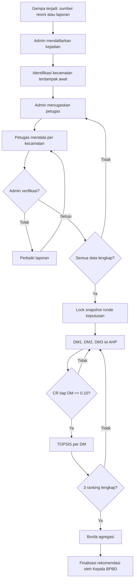

# Workflows, Use Cases, Status

## Workflow utama

## Use case rinci
### Admin / koordinator data
- Buat kejadian: masukkan nama, waktu, lokasi, magnitudo bila tersedia, sumber; status DRAFT.
- Tambahkan kecamatan awal dari informasi situasi; data belum final.
- Tugaskan satu atau lebih petugas per kecamatan (MVP satu petugas dapat mengisi banyak kecamatan).
- Verifikasi laporan per kecamatan, approve/reject dengan alasan.
- Pastikan semua kecamatan memiliki satu laporan valid untuk snapshot. Lock ronde.
- Pantau penilaian DM, lihat rekomendasi dan riwayat ronde.

### Petugas lapangan
- Lihat tugas per kecamatan.
- Catat `observed_at`, `source_note`, jumlah pengungsi, jumlah rentan, kerusakan, gangguan layanan dasar, stok vs kebutuhan, jam sejak bantuan terakhir.
- Simpan draft → kirim untuk verifikasi. Laporan ditolak → perbaiki → ajukan ulang.
- Usulkan kecamatan baru jika terdampak tetapi belum ada daftar; hanya admin yang menyetujui.

### Decision maker (3 akun berbeda)
- Lihat matriks nilai kecamatan yang sudah terverifikasi dan snapshot terkunci.
- Isi 15 pasangan AHP (6 kriteria). Nilai diagonal/resiprokal otomatis.
- Cek preview bobot dan CR. Jika CR > 0.10: revisi. Jika valid: submit dan lock.
- Lihat nilai dan ranking TOPSIS diri sendiri; hasil kelompok saat 3 DM complete.
- Kepala BPBD dapat finalisasi rekomendasi (tidak mengubah ranking numerik).

## Status model

Pada demo pendataan, penolakan atau persetujuan menutup versi laporan. Revisi dimulai sebagai versi baru dan riwayat pemeriksaan tetap tersimpan. Satu kecamatan dapat memiliki beberapa petugas, dengan satu laporan aktif (draf atau menunggu verifikasi) dalam satu waktu. Ringkasan admin menghitung kecamatan terverifikasi berdasarkan versi terbaru. Saat ini halaman penilaian memakai ronde simulasi awal.

### disaster_case
`DRAFT -> DATA_COLLECTION -> READY_FOR_ROUND -> IN_ASSESSMENT -> FINALIZED` (case may later start new round).
### field_report
`DRAFT -> SUBMITTED -> VERIFIED` atau `SUBMITTED -> REJECTED -> DRAFT`. Setiap perubahan sesudah verified perlu versi baru.
### assessment_round
`PREPARING -> LOCKED -> ASSESSING -> AGGREGATED -> FINALIZED`. Data snapshot immutable sejak LOCKED. `CANCELLED` hanya dengan alasan tertulis dan audit.
### dm_assessment
`NOT_STARTED -> DRAFT -> SUBMITTED`; server menerima SUBMITTED hanya saat CR ≤ 0.10, semua 15 perbandingan valid, dan ronde ASSESSING/LOCKED sesuai transisi teknis.

## Poin rawan
- Jika laporan terlambat masuk setelah lock, **jangan** otomatis menambah kecamatan ke ronde aktif; buat ronde baru untuk update.
- Jika suatu daerah baru terungkap terdampak, admin menambahnya ke case, tetapi penilaian terkunci tetap utuh.
- Jika data bertentangan, admin reject dan minta bukti/sumber. Tidak boleh menyembunyikan perbedaan dalam angka ranking.
- Persoalan yang memerlukan penyelamatan segera ditangani lewat prosedur darurat di luar ranking logistik.
