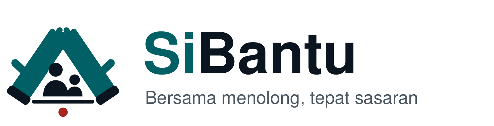

# Logo SiBantu — "Tangan yang Menjadi Atap"

## Gagasan utama

Saat gempa merobohkan rumah, yang pertama kali menaungi warga bukanlah bangunan, melainkan **tangan orang-orang yang menolong**. Logo SiBantu menggambarkan dua tangan yang ujung jarinya bertemu sehingga membentuk atap, dan di bawahnya ada keluarga yang terlindungi.

## Filosofi unsur

| Unsur | Bentuk | Makna |
|---|---|---|
| **Dua tangan** | Dua telapak tangan petrol dengan empat jari dan ibu jari yang terbuka | Pihak yang menolong: petugas pemerintah dan masyarakat. Tangan terbuka berarti siap memberi, bukan menggenggam. |
| **Ujung jari yang bertemu di puncak** | Jari tengah kedua tangan bersentuhan tepat di titik tertinggi | **Titik temu keputusan.** SiBantu adalah sistem pengambilan keputusan kelompok: setiap pihak menilai dengan sudut pandangnya sendiri, lalu hasilnya dipertemukan menjadi satu rekomendasi (AHP, TOPSIS, dan Borda). |
| **Atap dari tangan** | Kedua tangan membentuk segitiga atap | Hunian, posko, dan rasa aman. Atapnya dibentuk oleh manusia, yang berarti perlindungan lahir dari kepedulian. |
| **Tiga sudut segitiga** | Puncak dan dua pergelangan tangan | Tiga pengambil keputusan yang setara: **Kepala BPBD, Koordinator Lapangan, dan Perwakilan Dinas Sosial**. Segitiga juga bentuk yang paling kokoh, yaitu keputusan bersama lebih kuat daripada keputusan sendiri. |
| **Manset di pergelangan** | Pita gelap di ujung lengan | Lengan baju petugas di lapangan. Bantuan nyata dimulai dari orang yang turun langsung ke lapangan. |
| **Keluarga di bawah atap** | Satu orang dewasa dan satu anak | Warga terdampak sebagai pusat perhatian, khususnya **kelompok rentan** (anak, lansia), yang menjadi salah satu kriteria SiBantu (C3). |
| **Garis tanah** | Garis tinta di bawah keluarga | Pijakan yang kokoh, yaitu **data lapangan yang terverifikasi** sebagai dasar setiap keputusan. |
| **Titik merah** | Titik merah bata di bawah garis tanah | Titik gempa. Letaknya di bawah tanah dan ukurannya kecil, sedangkan yang besar dan menaungi adalah tangan-tangan penolong: **kepedulian lebih besar daripada bencananya**. |

**Tagline:** *Bersama menolong, tepat sasaran*: bersama (tiga pengambil keputusan bertemu di satu titik), tepat sasaran (prioritas kecamatan dari perhitungan yang transparan).

**Tulisan "SiBantu":** "Si" berwarna petrol (Sistem informasi) dan "Bantu" berwarna tinta. Teknologi hanya membantu; keputusan tetap di tangan manusia, seperti tangan pada logo.

## Warna

| Warna | Kode | Makna |
|---|---|---|
| Petrol | `#006065` | Ketenangan dan kepercayaan di tengah situasi darurat; warna utama tema SiBantu |
| Tinta | `#0b151f` | Keteguhan, ketegasan data, dan seragam petugas |
| Merah bata | `#a92321` | Kewaspadaan; hanya dipakai untuk titik gempa |

## Berkas

| Berkas | Kegunaan |
|---|---|
| `sibantu-logo.svg`, `sibantu-logo-1600.png` | Logo lengkap untuk latar terang (laporan, slide, sampul) |
| `sibantu-logo-putih.svg`, `sibantu-logo-putih-1600.png` | Logo lengkap untuk latar gelap/petrol |
| `sibantu-mark.svg`, `sibantu-mark-512.png` | Ikon saja, latar transparan |
| `sibantu-mark-putih.svg` | Ikon putih untuk latar gelap |
| `sibantu-mark-mono.svg` | Satu warna (cetak hitam-putih, stempel) |
| `sibantu-ikon-aplikasi.svg`, `sibantu-ikon-aplikasi-512.png`, `favicon.svg`, `apple-touch-icon.png` | Ikon aplikasi dan favicon browser |
| `pratinjau-logo.png` | Lembar pratinjau semua varian |

## Aturan pakai

- Beri ruang kosong di sekeliling logo minimal setinggi kepala figur dewasa.
- Ukuran ikon minimal 16 px; logo lengkap minimal lebar 120 px.
- Jangan memutar logo, mengubah warna titik gempa, memisahkan kedua tangan, atau menambah bayangan.
- Tulisan pada berkas SVG memakai font sistem (Segoe UI, atau Helvetica/Arial bila tidak tersedia). Untuk dokumen cetak, pakai berkas PNG agar bentuk huruf tetap.
